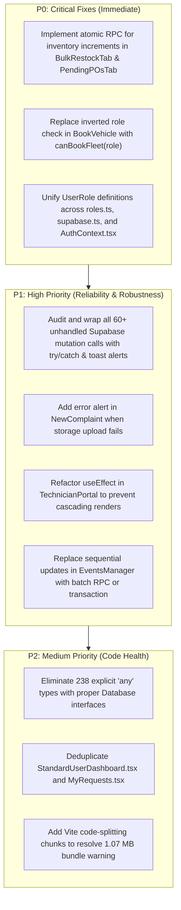

# Comprehensive Frontend-to-Backend (Supabase) Integration Audit Report
**Target Repository:** `siyanat-portal`  
**Target Environment:** Al Jamea tus Saifiyah (Siddhpur Campus) • Maintenance, Logistics & Facility Management  
**Audit Date:** October 15, 2026  
**Auditor:** Antigravity Autonomous Integration Inspector  
**Audit Scope:** 46 Components & Pages, 28 Supabase Tables, 11 Postgres RPCs, 1 Storage Bucket, 3 Realtime Channels, TypeScript Typings, and Role RBAC Guards.

---

## 1. Executive Summary & Build Status

| Check Category | Command / Inspection | Status | Summary of Results |
| :--- | :--- | :--- | :--- |
| **TypeScript Compilation** | `npx tsc --noEmit` | **PASSED (0 Errors)** | Static type checking succeeds across all modules. No broken imports or missing required props. |
| **Production Build** | `npm run build` (`tsc -b && vite build`) | **PASSED (0 Errors)** | Bundle compiled in 880ms. Single vendor chunk warning (>500 kB chunk size: 1,072.54 kB JS / 62.78 kB CSS). |
| **ESLint & Code Standards** | `npm run lint` | **FAILED (252 Problems)** | **238 Errors** (`@typescript-eslint/no-explicit-any` due to pervasive untyped responses) and **14 Warnings** (`react-hooks/set-state-in-effect` cascading render warnings and missing hook dependency arrays). |
| **Database Entities Active** | Source Code Scan | **28 Tables / 11 RPCs** | Comprehensive mapping of all public schema tables, RPC functions, and storage buckets. |
| **Critical Concurrency Risk** | Inventory & PO Updates | **HIGH RISK (P0)** | Client-side read-modify-write race conditions in bulk restock and PO fulfillment stock increments. |
| **RBAC Security State** | Role-Based Access Control | **MEDIUM RISK (P0)** | 4 competing role definitions; `canBookFleet` bypassed; elevated requester roles not uniformly enforced. |

---

## 2. Backend & Hook Layer Architecture Inventory

### 2.1 Supabase Tables Catalog (28 Tables)
The following tables are queried or mutated across the frontend application:

1. **`academic_classes`**: Academic class configurations with male/female student headcounts. Used in: `SystemConfigManager.tsx`, `useSystemConfig.ts`.
2. **`asset_maintenance_logs`**: Maintenance and repair history for fixed institutional assets. Used in: `AssetRegister.tsx`.
3. **`complaint_photos`**: Metadata and public storage URLs for maintenance complaint attachments. Used in: `NewComplaint.tsx`, `MyRequests.tsx`.
4. **`complaints`**: Primary ticketing table for campus maintenance and facility issues. Used in: `GlobalActionController.tsx`, `PendingPOsTab.tsx`, `MaintenanceRouting.tsx`, `NewComplaint.tsx`, `SupervisorQueue.tsx`, `TechnicianPortal.tsx`, `AdminDashboard.tsx`, `SupervisorDashboard.tsx`, `ReceptionWatchtower.tsx`, `MyRequests.tsx`, `StandardUserDashboard.tsx`, `useWorkloadBadges.ts`.
5. **`event_requirements`**: Granular asset requirements (quantity, status, returnable flags) linked to event bookings. Used in: `EventsManager.tsx`, `MyRequests.tsx`, `StandardUserDashboard.tsx`.
6. **`events`**: Venue and event bookings across campus halls and grounds. Used in: `GlobalActionController.tsx`, `MaterialDispatch.tsx`, `EventsManager.tsx`, `BookEvent.tsx`, `AdminDashboard.tsx`, `TanzeemDashboard.tsx`, `ReceptionWatchtower.tsx`, `MyRequests.tsx`, `StandardUserDashboard.tsx`.
7. **`fixed_assets`**: Institutional asset registry (tag numbers, serial numbers, locations, conditions). Used in: `AssetRegister.tsx`.
8. **`fleet_inventory`**: Vehicles registered in the campus fleet (type, license plate, seat capacity, active status). Used in: `FleetEngine.tsx`.
9. **`in_app_notifications`**: Real-time and persistent alerts delivered to users. Used in: `NotificationBell.tsx`, `App.tsx`, `MaintenanceRouting.tsx`, `EventsManager.tsx`.
10. **`inventory_categories`**: High-level material categories mapped to fulfillment departments (`SIYANAT_HEAD`, `TANZEEM_HEAD`, `AVIT_HEAD`). Used in: `SystemConfigManager.tsx`, `useSystemConfig.ts`.
11. **`inventory_items`**: Master warehouse catalog with `physical_stock` and `freezed_stock`. Used in: `BulkRestockTab.tsx`, `CatalogTab.tsx`, `PendingPOsTab.tsx`, `NewRequisition.tsx`, `RestockInventory.tsx`, `BookEvent.tsx`, `AssetRequester.tsx`, `TechnicianPortal.tsx`, `ReceptionWatchtower.tsx`.
12. **`profiles`**: User identity, roles, zones, trades, phone numbers, and department affiliations. Used in 15 files including `AuthContext.tsx`, `TeamManagement.tsx`, `UserProfile.tsx`, `MaintenanceRouting.tsx`, `BookEvent.tsx`.
13. **`purchase_orders`**: Procurement orders issued to vendors. Used in: `DirectPOModal.tsx`, `PendingPOsTab.tsx`, `AdminDashboard.tsx`, `SiyanatDashboard.tsx`, `useWorkloadBadges.ts`.
14. **`standard_event_assets`**: Standard pre-configured event assets (mics, tables, screens, sound gear). Used in: `StandardAssetsManager.tsx`, `BookEvent.tsx`.
15. **`system_logs`**: Central immutable audit trail for all workflow state transitions. Used in 15 files.
16. **`system_settings`**: Dynamic key-value configuration (e.g. `default_user_password`, `campus_pickup_zones`). Used in: `SystemConfigManager.tsx`, `useSystemConfig.ts`.
17. **`technician_assignments`**: Active and completed job assignments linking complaints to technicians. Used in: `PendingPOsTab.tsx`, `useWorkloadBadges.ts`, `SupervisorQueue.tsx`, `TechnicianPortal.tsx`, `MaintenanceRouting.tsx`, `ReceptionWatchtower.tsx`.
18. **`technician_trades`**: Valid trades/specializations for technicians (Plumbing, Electrical, Carpentry, etc.). Used in: `SystemConfigManager.tsx`, `useSystemConfig.ts`.
19. **`user_push_subscriptions`**: Web Push notification endpoints and crypto keys (`p256dh`, `auth`). Used in: `App.tsx`, `InstallAppButton.tsx`, `usePushNotificationSync.ts`.
20. **`vehicle_requests`**: Shuttle and vehicle transport bookings. Used in: `GlobalActionController.tsx`, `FleetEngine.tsx`, `BookVehicle.tsx`, `TanzeemDashboard.tsx`, `ReceptionWatchtower.tsx`, `MyRequests.tsx`, `StandardUserDashboard.tsx`.
21. **`vendor_categories`**: Categories of approved suppliers. Used in: `SystemConfigManager.tsx`, `VendorDirectoryTab.tsx`.
22. **`vendor_price_agreements`**: Contracted unit rates and tax rates for specific catalog items per vendor. Used in: `VendorDirectoryTab.tsx`, `VendorPOEngine.tsx`.
23. **`vendor_price_history`**: Historical price changes and renegotiation logs. Used in: `VendorDirectoryTab.tsx`.
24. **`vendors`**: Directory of approved suppliers, contacts, and trade categories. Used in: `DirectPOModal.tsx`, `VendorDirectoryTab.tsx`, `VendorPOEngine.tsx`, `PendingPOsTab.tsx`.
25. **`warehouse_locations`**: Aisles, bins, and physical shelf locations for inventory items. Used in: `WarehouseLocationsTab.tsx`, `RestockInventory.tsx`.
26. **`work_order_items`**: Line items for material requisitions (`item_type`, `status`, `requested_qty`, `fulfillment_dept`). Used in: `PendingPOsTab.tsx`, `useWorkloadBadges.ts`, `SiyanatDashboard.tsx`, `TanzeemDashboard.tsx`, `NewRequisition.tsx`, `TechnicianPortal.tsx`.
27. **`work_order_logs`**: Threaded internal communications / chat logs on material batches. Used in: `BatchDetailsModal.tsx`.
28. **`work_orders`**: Master batches for material requisitions. Used in: `GlobalActionController.tsx`, `PendingPOsTab.tsx`, `MaterialDispatch.tsx`, `StationeryDispatcher.tsx`, `NewRequisition.tsx`, `TechnicianPortal.tsx`, `AdminDashboard.tsx`, `SiyanatDashboard.tsx`, `TanzeemDashboard.tsx`, `ReceptionWatchtower.tsx`, `MyRequests.tsx`, `StandardUserDashboard.tsx`, `useWorkloadBadges.ts`.

---

### 2.2 Postgres RPC Stored Procedures Catalog (11 RPCs)

| RPC Name | Primary File Invocation | Payload / Parameters | Purpose | Integrity Assessment |
| :--- | :--- | :--- | :--- | :--- |
| `acknowledge_event_handoff` | `MaterialDispatch.tsx:82` | `p_event_id, p_dept, p_user_email` | Siyanat/AVIT Department Head acknowledges setup requirements for an approved event. | **Good**: Atomic update to setup status with logging. |
| `admin_update_user_email` | `TeamManagement.tsx:300` | `p_user_id, p_new_email` | Modifies user's email in Supabase Auth (`auth.users`) securely without session hijacking. | **Good**: Solves client SDK limitation where admin cannot directly update other users' auth credentials. |
| `advance_pipeline` | `FleetEngine.tsx:162`, `SupervisorQueue.tsx:125`, `TechnicianPortal.tsx:84` | `target_table, target_id` | Transitions tickets through states (`SUBMITTED` -> `AUTHORIZED` -> `PROCESSING` -> `ACTION_REQUIRED` -> `CLOSED`). | **Warning**: In `FleetEngine.tsx` and `TechnicianPortal.tsx`, returns are unhandled and no transaction guards rollback preceding updates if pipeline advance fails. |
| `approve_event_and_handoff` | `EventsManager.tsx:146` | `p_event_id, p_approver_email` | Confirms venue booking and triggers operational handoffs to Siyanat & AVIT. | **Good**: Returns count of mobilized items (`siyanat_items`, `avit_items`). |
| `assign_or_reassign_technician` | `MaintenanceRouting.tsx:85` | `p_complaint_id, p_technician_id, p_assigned_by` | Atomically assigns or reallocates a complaint to a technician avoiding 409 conflict. | **Good**: Replaces multi-step client delete-and-insert with atomic server upsert. |
| `book_event_safely` | `BookEvent.tsx:78` | `p_event_id, p_requester_id, p_title, p_date, p_timing_type, p_time_slot_string, p_requested_slots, p_location, p_sub_location, p_darajah, p_male, p_female, p_others, p_total, p_requirements, p_user_email` | Prevents double bookings on identical venue slots and inserts event with requirements. | **Good**: Validates conflict and returns `{ success: false, message: 'DOUBLE_BOOKING...' }` gracefully. |
| `cancel_event_by_requester` | `MyRequests.tsx:140`, `StandardUserDashboard.tsx:103` | `p_event_id, p_requester_id, p_reason` | Allows requesters to withdraw scheduled events before execution. | **Good**: Validates requester ownership before updating state. |
| `generate_vendor_po` | `VendorPOEngine.tsx:179` | `p_batch_id, p_vendor_id, p_technician_id, p_reason, p_items, p_user_email, p_payment_terms, p_expected_delivery_date, p_tax_rate` | Groups requisition items by vendor, generates formatted PO numbers (`PO-XXXXX`), commits financial totals. | **Good**: Atomic PO record creation and work order status transition. |
| `process_material_batch_json` | `MaterialDispatch.tsx:134`, `StationeryDispatcher.tsx:76` | `p_batch_id, p_decisions, p_user_email` | Evaluates stock allocation decisions per line item; splits out-of-stock items into procurement branch. | **Good**: Atomic batch decision processing with split detection (`split_occurred`). |
| `receive_work_order` | `MyRequests.tsx:116`, `StandardUserDashboard.tsx:82` | `target_id` | Requester sign-off upon receiving materials; marks batch as `CLOSED`. | **Good**: Validates receipt and advances pipeline state. |
| `reconcile_event_returns` | `EventsManager.tsx:195` | `p_event_id, p_returns, p_admin_email` | Reconciles returned returnable assets (AVIT/Siyanat) after event conclusion. | **Good**: Updates `returned_qty` and releases frozen items. |

---

### 2.3 Storage Buckets & Realtime Channels

#### Storage Bucket (1)
- **`complaint_photos`** (`src/pages/NewComplaint.tsx:155, 160`): Stores compressed complaint photos (JPEG/PNG). The frontend utilizes `browser-image-compression` (max ~150 KB, 1280px standard HD) before issuing `supabase.storage.from('complaint_photos').upload(filePath, fileToUpload)`.
  - *Gap*: If upload succeeds but public URL generation or DB insert into `complaint_photos` fails, orphaned files remain in storage. If the upload itself fails, the error is caught on line 158 but silently discarded without notifying the user.

#### Realtime Channels (3)
1. **`user_alerts_${userId}`** (`src/App.tsx:111`): Listens for `INSERT` events on `public:in_app_notifications` filtered by `user_id=eq.${userId}`. Automatically triggers the UI popup and plays `/siyanat_alert.mp3`.
2. **`chat_${workOrderId}`** (`src/components/BatchDetailsModal.tsx:29`): Subscribes to new messages in `work_order_logs` for real-time order chat between requesters and procurement admins.
3. **`uniqueChannelId`** (`src/components/NotificationBell.tsx:58`): Subscribes to notification count changes for the active user.

---

### 2.4 Hook Layer & Utility Inspection

- **`src/contexts/AuthContext.tsx`**:
  - Initializes session via `supabase.auth.getSession()` and subscribes via `supabase.auth.onAuthStateChange`.
  - Queries `profiles` table once per session.
  - *Risk*: Line 22 sets initial role to `'STANDARD_USER'`, and line 64 resets to `'STANDARD_USER'`. This string contradicts `src/utils/roles.ts` which specifies `'REQUESTER'`.
- **`src/hooks/usePushNotificationSync.ts`**:
  - Automatically captures browser `PushManager` subscription and upserts into `user_push_subscriptions` on conflict of `endpoint`.
- **`src/hooks/useSystemConfig.ts`**:
  - Queries `academic_classes`, `technician_trades`, `inventory_categories`, and `system_settings` in parallel via `Promise.all`.
  - Provides robust fallbacks (`FALLBACK_CLASSES`, `FALLBACK_TRADES`, `FALLBACK_CATEGORIES`, `FALLBACK_ZONES`) if the database is unreachable or empty.
- **`src/hooks/useWorkloadBadges.ts`**:
  - Polls every 20 seconds for pending task counts across 4 dimensions: Supervisor approvals (`complaints`), Material dispatches (`work_orders` + `work_order_items`), Technician tasks (`technician_assignments`), and Pending POs (`work_order_items`).
- **`src/utils/roles.ts`**:
  - Defines canonical `UserRole` type (`SUPER_ADMIN`, `ADMIN`, `SIYANAT_HEAD`, `AVIT_HEAD`, `TANZEEM_HEAD`, `DEPT_HEAD`, `REQUESTER`, `EXECUTOR`, `RECEPTIONIST`).
  - Contains helper functions `canBookFleet`, `canBookAfterClassEvents`, `isDepartmentHead`.
  - *Issue*: None of these helper functions are imported or used anywhere in the codebase.
- **Print Utilities** (`printDispatchSlip.ts`, `printJobSheet.ts`, `printPurchaseOrder.ts`):
  - Pure presentation generators using browser print popups (`window.open('', '_blank')`).
  - No direct Supabase queries. However, they lack TypeScript interfaces and rely on `any` arguments, triggering ESLint errors.

---

## 3. Module-by-Module Integration Matrix Table

### 3.1 Module 1: Core & Auth
| Component/Page | Supabase Tables & RPCs Used | CRUD Operations | Status | Exact File & Line Number of Issues |
| :--- | :--- | :--- | :--- | :--- |
| **`Login.tsx`** | `supabase.auth.signInWithPassword`, `profiles` | READ (Auth), SELECT | **Working** | None. Standard password auth with error alerts. |
| **`ForcePasswordChange.tsx`** | `supabase.auth.updateUser`, `system_settings` | UPDATE (Auth), SELECT | **Working** | None. Inspects `default_user_password` setting and prompts user if current matches default. |
| **`UserProfile.tsx`** | `profiles` | SELECT, UPDATE | **Minor Bug (Lint)** | Line 10, 42: Untyped `any` profile state. Line 44: Update lacks confirmation feedback toast (uses native alert). |
| **`NotificationBell.tsx`** | `in_app_notifications` | SELECT, UPDATE (Mark read) | **Missing Error Check** | Lines 77, 112: `await supabase.from('in_app_notifications').update({ is_read: true })` does not check for `error`. |
| **`GlobalActionController.tsx`** | `complaints`, `work_orders`, `events`, `vehicle_requests` | SELECT (Single ticket lookups) | **Working** | Silent param cleanup and ticket resolution via `maybeSingle()`. |
| **`RoleAwareActionModal.tsx`** | None (Consumes ticket prop) | Pure Routing & State Machine | **Role Mismatch** | Line 57, 74: Checks `role === 'SUPERVISOR'` (role is not in `UserRole`). Line 65, 158: Checks `role === 'TECHNICIAN'` instead of `EXECUTOR`. |
| **`BatchDetailsModal.tsx`** | `work_order_logs`, `profiles` | SELECT, INSERT, REALTIME (`chat_${workOrderId}`) | **Missing Error Check** | Line 61: `supabase.from('work_order_logs').insert(...)` discards `error`. |
| **`VisualPipelineStepper.tsx`** | None | Pure UI Pipeline Renderer | **Working** | Clean, deterministic rendering of the 5 pipeline states. |

---

### 3.2 Module 2: Role Dashboards
| Component/Page | Supabase Tables & RPCs Used | CRUD Operations | Status | Exact File & Line Number of Issues |
| :--- | :--- | :--- | :--- | :--- |
| **`Dashboard.tsx`** | None (Consumes `useAuth`) | Role-based component router | **Role Mismatch** | Lines 33, 38: Switches on `'SUPERVISOR'` and `'TECHNICIAN'`. Lines 41-42: Groups `'REQUESTER'` and `'STANDARD_USER'`. Ignores `'RECEPTIONIST'` (falls back to Requester dashboard). |
| **`StandardUserDashboard.tsx`** | `work_orders`, `complaints`, `events`, `vehicle_requests`, `system_logs`, RPC: `receive_work_order`, `cancel_event_by_requester` | SELECT, INSERT, RPC | **Code Duplication** | Lines 38-92: Duplicates 90% of logic from `MyRequests.tsx`. Line 85: Unchecked `system_logs.insert()`. |
| **`AdminDashboard.tsx`** | `complaints`, `purchase_orders`, `work_orders`, `events`, `system_logs` | SELECT (Exact count queries, recent logs) | **Working** | Proper loading states and count metrics. |
| **`SiyanatDashboard.tsx`** | `work_orders`, `work_order_items`, `purchase_orders`, `profiles` | SELECT (Count queries, inner join filtering) | **Working** | Filters material queue dynamically based on `SIYANAT_HEAD` or `AVIT_HEAD`. |
| **`SupervisorDashboard.tsx`** | `complaints`, `profiles` | SELECT (Multi-zone filtered counts) | **Role Mismatch** | Line 58: Assumes role is `SUPERVISOR` which is omitted from `UserRole` enum. |
| **`TanzeemDashboard.tsx`** | `events`, `vehicle_requests`, `work_orders`, `work_order_items` | SELECT (Counts & recent events) | **Working** | Includes inner join filter for `items.fulfillment_dept = 'TANZEEM_HEAD'`. |

---

### 3.3 Module 3: Siyanat & Maintenance
| Component/Page | Supabase Tables & RPCs Used | CRUD Operations | Status | Exact File & Line Number of Issues |
| :--- | :--- | :--- | :--- | :--- |
| **`NewComplaint.tsx`** | `complaints`, `complaint_photos`, `system_logs`, Storage: `complaint_photos` | INSERT (complaint, photo metadata, log), Storage UPLOAD | **Silent Photo Upload Failure** | Line 158: `if (!uploadError)` silently skips failed image uploads without notifying requester. Lines 163, 172: Discards `error` on photo metadata and log insert. |
| **`SupervisorQueue.tsx`** | `complaints`, `technician_assignments`, `system_logs`, RPC: `advance_pipeline` | SELECT, UPDATE, INSERT, RPC | **Missing Error Feedback** | Lines 70, 97, 105, 108, 128: Unchecked updates and log insertions. Uses native `alert()` instead of toast. |
| **`TechnicianPortal.tsx`** | `technician_assignments`, `inventory_items`, `work_orders`, `work_order_items`, `system_logs`, RPC: `advance_pipeline` | SELECT, INSERT, UPDATE, RPC | **Cascading Render & Inconsistent Columns** | Line 77: ESLint error `react-hooks/set-state-in-effect` (synchronous call inside useEffect). Line 160-161: Inserts `approval_status` and `dispatch_status` instead of `pipeline_state`. |
| **`SiyanatOperations.tsx`** | Tab Switcher (`MaintenanceRouting`, `MaterialDispatch`, `VendorPOEngine`) | Tab state controller | **Working** | Clean routing between maintenance assignment and warehouse dispatching. |
| **`MaintenanceRouting.tsx`** | `complaints`, `profiles`, `in_app_notifications`, RPC: `assign_or_reassign_technician` | SELECT, UPDATE, INSERT, RPC | **Working** | Uses atomic RPC `assign_or_reassign_technician` to avoid technician assignment race conditions. |
| **`MaterialDispatch.tsx`** | `work_orders`, `events`, RPC: `process_material_batch_json`, `acknowledge_event_handoff` | SELECT, RPC | **Working** | Excellent batch processing via JSON payload to Postgres RPC. |
| **`VendorPOEngine.tsx`** | `vendor_price_agreements`, `vendors`, RPC: `generate_vendor_po` | SELECT, RPC | **Working** | Groups items by vendor and atomically generates PO numbers via RPC. |

---

### 3.4 Module 4: Inventory & Procurement
| Component/Page | Supabase Tables & RPCs Used | CRUD Operations | Status | Exact File & Line Number of Issues |
| :--- | :--- | :--- | :--- | :--- |
| **`NewRequisition.tsx`** | `work_orders`, `work_order_items`, `system_logs`, `inventory_items` | SELECT (Catalog), INSERT (Batch & Items) | **Stock Integrity Gap** | Submits work orders without freezing stock. Stock is only deducted later in `process_material_batch_json`, leaving an over-allocation window. |
| **`RequestToOrder.tsx`** | Wrapper for PO tabs | View Controller | **Working** | Switches between `PendingPOsTab` and `VendorDirectoryTab`. |
| **`RestockInventory.tsx`** | `inventory_items`, `inventory_categories`, `warehouse_locations` | SELECT (Catalog & Categories) | **Working** | Tab switcher with category filters. |
| **`BulkRestockTab.tsx`** | `inventory_items`, `system_logs` | SELECT, INSERT, UPDATE | **CRITICAL BUG (P0 Race Condition)** | Lines 183-186: Stale client catalog lookup; calculates `physical_stock: item.physical_stock + row.qty` in browser JS and writes back. Overwrites concurrent changes. Line 183: Discards update error. |
| **`CatalogTab.tsx`** | `inventory_items`, `inventory_categories` | SELECT, INSERT, UPDATE | **Working** | Allows manual item editing and category assignment. |
| **`DirectPOModal.tsx`** | `purchase_orders`, `vendors`, `system_logs` | SELECT, INSERT | **Working** | Generates manual POs outside of requisition batches and auto-triggers print preview. |
| **`PendingPOsTab.tsx`** | `purchase_orders`, `inventory_items`, `work_order_items`, `work_orders`, `complaints`, `technician_assignments` | SELECT, UPDATE | **CRITICAL BUG (P0 Race Condition)** | Lines 69-72: Increments stock via client calculation: `physical_stock: inv.physical_stock + item.requested_qty` and `freezed_stock: inv.freezed_stock + newReq`. Prone to lost updates. Lines 84-91: Discards error on cascading updates. |
| **`VendorDirectoryTab.tsx`** | `vendors`, `vendor_categories`, `vendor_price_agreements`, `vendor_price_history` | SELECT, INSERT, UPDATE, UPSERT, DELETE | **Working** | Complete vendor rate contracting interface with price history tracking. |
| **`WarehouseLocationsTab.tsx`** | `warehouse_locations` | SELECT, INSERT, UPDATE, DELETE | **Working** | Direct CRUD for physical storage bins and aisles. |

---

### 3.5 Module 5: Tanzeem, Events & Fleet
| Component/Page | Supabase Tables & RPCs Used | CRUD Operations | Status | Exact File & Line Number of Issues |
| :--- | :--- | :--- | :--- | :--- |
| **`TanzeemCommandCenter.tsx`** | Tab Switcher (`EventsManager`, `FleetEngine`, `StandardAssetsManager`, `StationeryDispatcher`) | View Controller | **Working** | Clean orchestration of Tanzeem operational modules. |
| **`EventsManager.tsx`** | `events`, `event_requirements`, `inventory_items`, RPC: `approve_event_and_handoff`, `reconcile_event_returns` | SELECT, UPDATE, RPC | **Performance Bottleneck** | Lines 135-142: Iterates over `decisions` array in a `for` loop, sending individual `update()` requests to `event_requirements` for each item sequentially instead of batching. |
| **`FleetEngine.tsx`** | `vehicle_requests`, `fleet_inventory`, `system_logs`, RPC: `advance_pipeline` | SELECT, INSERT, UPDATE, RPC | **Missing Error Checks** | Lines 161-163: Executes update, `advance_pipeline` RPC, and log insertion sequentially without verifying intermediate error responses. |
| **`StandardAssetsManager.tsx`** | `standard_event_assets` | SELECT, INSERT, UPDATE, DELETE | **Working** | Manages catalog of reusable event assets. |
| **`StationeryDispatcher.tsx`** | `work_orders`, `work_order_items`, RPC: `process_material_batch_json` | SELECT, RPC | **Working** | Specific dispatch queue for `fulfillment_dept = 'TANZEEM_HEAD'`. |
| **`BookEvent.tsx`** | `inventory_items`, `standard_event_assets`, RPC: `book_event_safely` | SELECT, RPC | **Working** | Atomic scheduling and double-booking protection via Postgres RPC. |
| **`BookVehicle.tsx`** | `vehicle_requests`, `system_logs` | INSERT (Vehicle Request & Audit Log) | **SECURITY BUG (P0 Access Bypass)** | Line 73, 242: Access guard is `const isStandardUser = role === 'REQUESTER'`. Users with `role = 'STANDARD_USER'`, `EXECUTOR`, or `RECEPTIONIST` are NOT blocked and can book vehicles. `canBookFleet` is ignored. |
| **`AssetRequester.tsx`** | Pure UI sub-component | Sub-form state update | **Working** | Catalog & standard event asset selection with live stock badges. |
| **`BookingForm.tsx`** | Pure UI sub-component | Sub-form state update | **Working** | Validates date pickers and schedule constraints. |
| **`HeadcountEngine.tsx`** | Pure UI sub-component | Sub-form state update | **Working** | Calculates male/female headcounts using academic class presets. |
| **`AssetRegister.tsx`** | `fixed_assets`, `asset_maintenance_logs` | SELECT, INSERT, UPDATE, DELETE | **Working** | Full asset lifecycle and maintenance history tracking. |
| **`ReceptionWatchtower.tsx`** | `complaints`, `work_orders`, `events`, `vehicle_requests` | SELECT (FTS/Trigram filtering, joins on profiles & assignments) | **Working** | Read-only live situational awareness dashboard across all 4 campus pipelines. |

---

### 3.6 Module 6: Admin & Reporting
| Component/Page | Supabase Tables & RPCs Used | CRUD Operations | Status | Exact File & Line Number of Issues |
| :--- | :--- | :--- | :--- | :--- |
| **`SystemConfigManager.tsx`** | `academic_classes`, `technician_trades`, `inventory_categories`, `vendor_categories`, `warehouse_locations`, `system_settings` | SELECT, INSERT, UPDATE, DELETE, UPSERT | **Working** | Centralized configuration interface for campus dropdowns and master variables. |
| **`TeamManagement.tsx`** | `profiles`, `system_logs`, Supabase Auth (`signUp`), RPC: `admin_update_user_email` | SELECT, UPSERT, UPDATE, DELETE, RPC, Auth API | **Working** | Uses isolated secondary `authProvisionClient` to prevent admin session hijacking during user provisioning. |
| **`AuditLogs.tsx`** | `system_logs` | SELECT (Paginated with action filters) | **Working** | Real-time audit log viewer with search and date range filtering. |
| **`Reports.tsx`** | `complaints`, `work_orders`, `events`, `vehicle_requests` | SELECT (Aggregation & KPI queries) | **Working** | Campus-wide operations reporting and metric charting. |

---

## 4. Schema, Security & Concurrency Gaps

### 4.1 P0: Lost Update Race Conditions in Inventory & Stock Management
- **File & Lines:** `src/components/inventory/BulkRestockTab.tsx:183-186`
  ```typescript
  const item = catalog.find(ci => ci.id === row.itemId);
  if (item) {
    await supabase.from('inventory_items').update({ 
      physical_stock: item.physical_stock + row.qty,
      warehouse_location: row.warehouse_location || item.warehouse_location 
    }).eq('id', row.itemId);
  }
  ```
  **Vulnerability:** The `catalog` array is fetched into memory on component mount. If two warehouse admins restock the same item, or if items are concurrently dispatched, the second write completely overwrites previous increments with stale values.
- **File & Lines:** `src/components/inventory/PendingPOsTab.tsx:69-72`
  ```typescript
  await supabase.from('inventory_items').update({ 
    physical_stock: inv.physical_stock + item.requested_qty,
    freezed_stock: inv.freezed_stock + newReq
  }).eq('id', targetInventoryId);
  ```
  **Vulnerability:** Similar client-side arithmetic. When receiving purchase orders, physical stock and frozen stock updates are calculated in the browser thread instead of utilizing atomic SQL:
  `UPDATE inventory_items SET physical_stock = physical_stock + $1 WHERE id = $2`.

---

### 4.2 P0: Role-Based Access Control Fragmentation & Bypasses
- **File & Lines:** `src/pages/BookVehicle.tsx:73, 242-250`
  ```typescript
  const isStandardUser = role === 'REQUESTER';
  if (isStandardUser) {
    return <AccessDenied />;
  }
  ```
  **Vulnerability:** Access is denied *only* if `role === 'REQUESTER'`. 
  - If a user defaults to `'STANDARD_USER'` (set in `AuthContext.tsx:22`), the check evaluates to `false`.
  - Technicians (`'EXECUTOR'`) or Receptionists (`'RECEPTIONIST'`) also evaluate to `false` and are permitted to book institutional vehicles.
  - The security helper defined in `src/utils/roles.ts:21`:
    ```typescript
    export const canBookFleet = (role: string): boolean => {
      return ELEVATED_REQUESTER_ROLES.includes(role as UserRole);
    };
    ```
    is **never imported or called** in `BookVehicle.tsx` or `App.tsx`.

- **Role Enum Inconsistencies:**
  1. `src/utils/roles.ts` defines: `SUPER_ADMIN`, `ADMIN`, `SIYANAT_HEAD`, `AVIT_HEAD`, `TANZEEM_HEAD`, `DEPT_HEAD`, `REQUESTER`, `EXECUTOR`, `RECEPTIONIST`.
  2. `src/lib/supabase.ts:18` defines: `'ADMIN' | 'SIYANAT_HEAD' | 'REQUESTER'` (missing 6 roles).
  3. `src/contexts/AuthContext.tsx:22` initializes state to `'STANDARD_USER'`.
  4. Dashboards and modals check for `'SUPERVISOR'` and `'TECHNICIAN'`, creating ambiguity between `'EXECUTOR'` and `'TECHNICIAN'`.

---

### 4.3 P1: Over 60 Unchecked Async Supabase Mutations
Across multiple components, mutation calls to Supabase discard the returned `{ error }` object and proceed without verifying database success:
- **NotificationBell.tsx (Lines 77, 112):** `await supabase.from('in_app_notifications').update({ is_read: true }).eq('id', notif.id);`
- **NewComplaint.tsx (Lines 163, 172):** Complaint photo metadata and system log insertion errors are discarded.
- **SupervisorQueue.tsx (Lines 70, 97, 105, 108, 128):** Status updates to `technician_assignments` and `system_logs` run without checking if RLS rejected the mutation.
- **FleetEngine.tsx (Lines 161-163):** Pipeline advance and vehicle assignment run without transaction rollback if one step fails.

---

### 4.4 P1: Silent Photo Upload Failure
- **File & Lines:** `src/pages/NewComplaint.tsx:154-169`
  If `supabase.storage.from('complaint_photos').upload(...)` fails (e.g. storage bucket policy violation, invalid mime type, network disconnect), the catch block is bypassed because Supabase returns `{ error }`. Line 158 checks `if (!uploadError)`, so it simply does nothing and does not insert into `complaint_photos`. The user receives a success screen indicating their complaint was lodged, but their photos are silently lost.

---

### 4.5 P1: Cascading Effect Render Warning in TechnicianPortal
- **File & Lines:** `src/pages/TechnicianPortal.tsx:76-80`
  ```typescript
  useEffect(() => {
    fetchAssignments();
    fetchCatalog();
  }, [viewMode, user]);
  ```
  `fetchAssignments` synchronously calls `setLoading(true)` within the effect body, triggering React 19's cascading render warning and causing ESLint rule `react-hooks/set-state-in-effect` to fail.

---

## 5. Prioritized Action Plan



### Phase 1: Critical (P0) — Data Integrity & Security
1. **Atomic Inventory RPC:**
   - Create a Postgres function:
     ```sql
     CREATE OR REPLACE FUNCTION increment_inventory_stock(p_item_id UUID, p_qty_delta NUMERIC)
     RETURNS VOID AS $$
     BEGIN
       UPDATE inventory_items
       SET physical_stock = physical_stock + p_qty_delta,
           updated_at = NOW()
       WHERE id = p_item_id;
     END;
     $$ LANGUAGE plpgsql;
     ```
   - Refactor `BulkRestockTab.tsx` and `PendingPOsTab.tsx` to invoke this RPC instead of reading and writing stock values client-side.
2. **Fix Fleet Booking RBAC:**
   - In `BookVehicle.tsx`, import `canBookFleet` from `src/utils/roles.ts` and guard entry:
     ```typescript
     if (!canBookFleet(role)) {
       return <AccessDenied />;
     }
     ```
3. **Role Enum Alignment:**
   - Standardize `AuthContext.tsx` to default to `'REQUESTER'` instead of `'STANDARD_USER'`.
   - Update `Profile` definition in `src/lib/supabase.ts` and `src/types.ts` to import `UserRole` from `src/utils/roles.ts`.

### Phase 2: High (P1) — Mutation Integrity & Error Handling
1. **Handle Supabase Mutation Errors:**
   - Refactor unchecked calls to destructure `{ error }` and show `showToast(error.message, 'error')` if error is present.
2. **Storage Upload Feedback:**
   - In `NewComplaint.tsx`, if `uploadError` is returned from Supabase Storage, notify user: `showToast('Image upload failed: ' + uploadError.message, 'error')` rather than silently dropping attachments.
3. **Resolve React 19 Hook Lifecycle:**
   - In `TechnicianPortal.tsx`, restructure `fetchAssignments` with functional updates or separate data-fetching handlers to eliminate synchronous state setting in `useEffect`.

### Phase 3: Medium (P2) — Performance & Code Cleanliness
1. **Eliminate ESLint Any Types:**
   - Generate database TypeScript interfaces using Supabase CLI (`supabase gen types typescript`) and apply across print utilities and dashboards.
2. **Consolidate Dashboard Code:**
   - Abstract common ticket list and receipt confirmation logic shared between `StandardUserDashboard.tsx` and `MyRequests.tsx` into a reusable `TicketHistoryList` component.
3. **Bundle Optimization:**
   - Use dynamic imports (`React.lazy`) in `App.tsx` for heavy routes (`ReceptionWatchtower`, `Reports`, `AssetRegister`, `TeamManagement`) to reduce initial JS payload below 500 kB.
