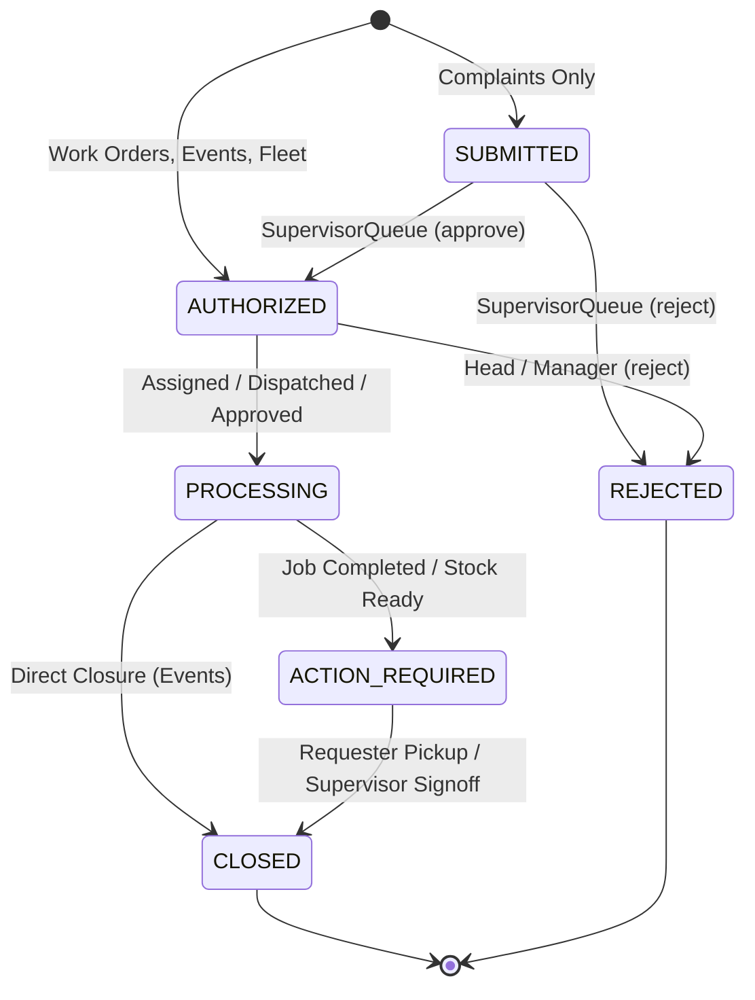
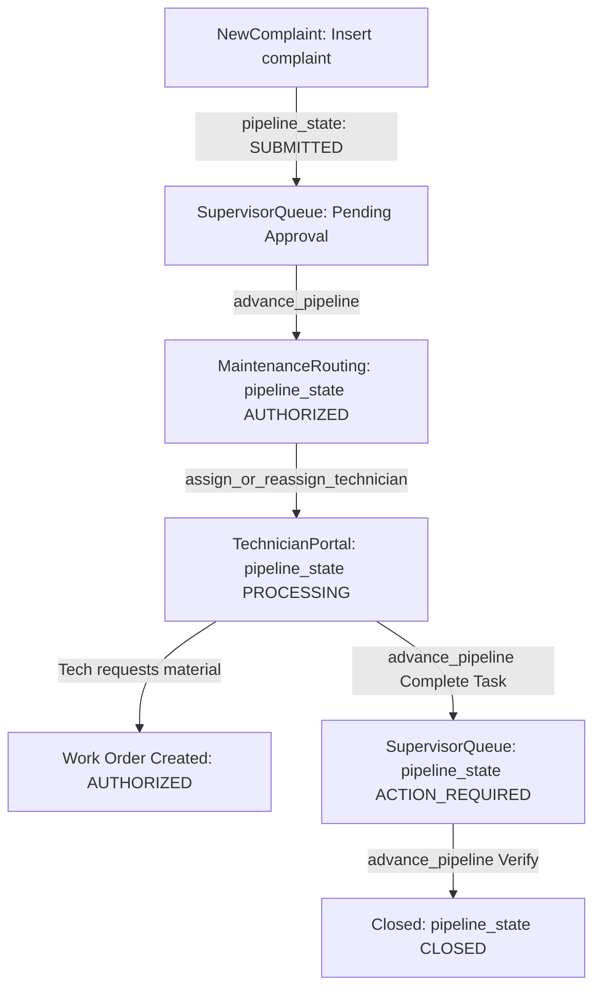
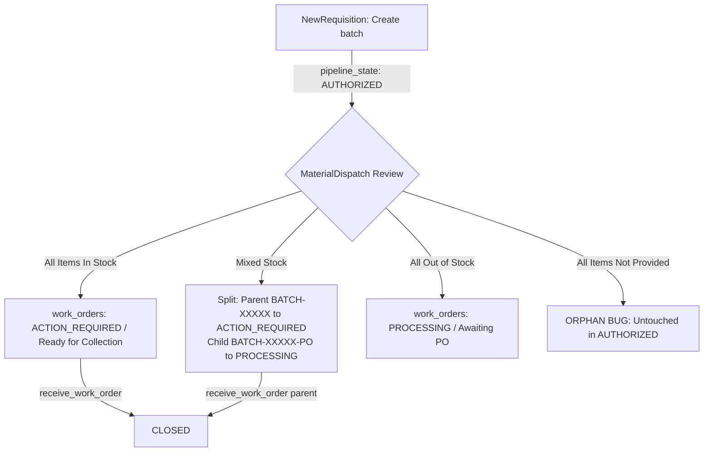
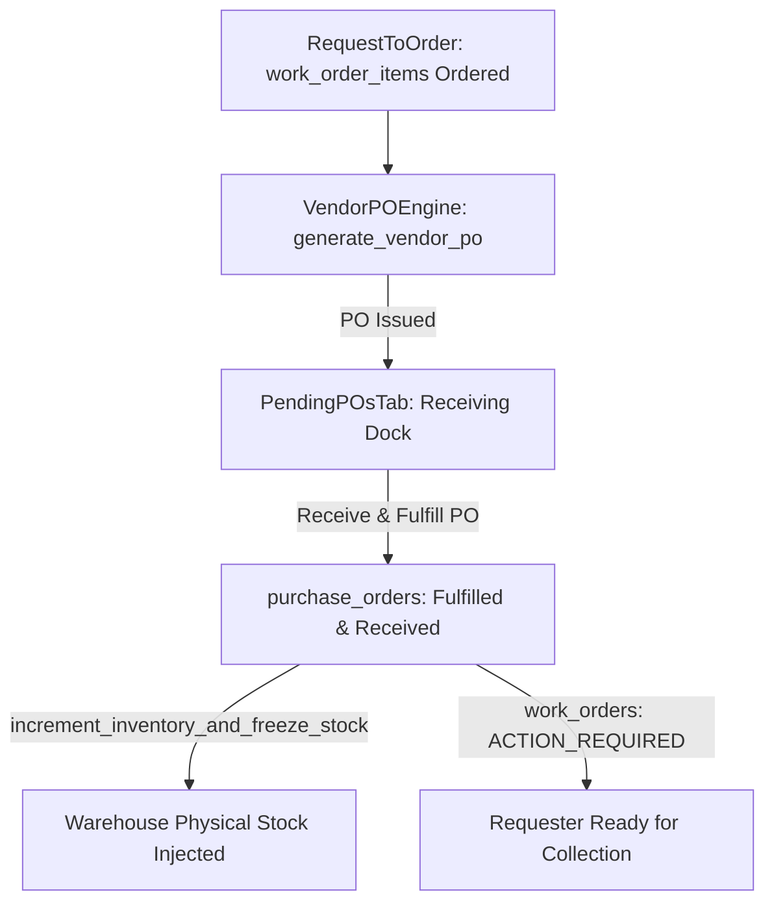
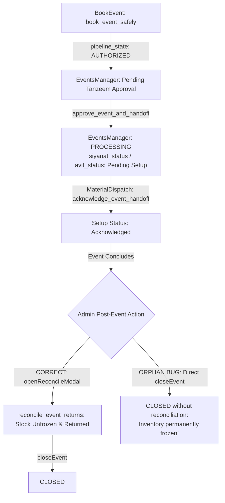
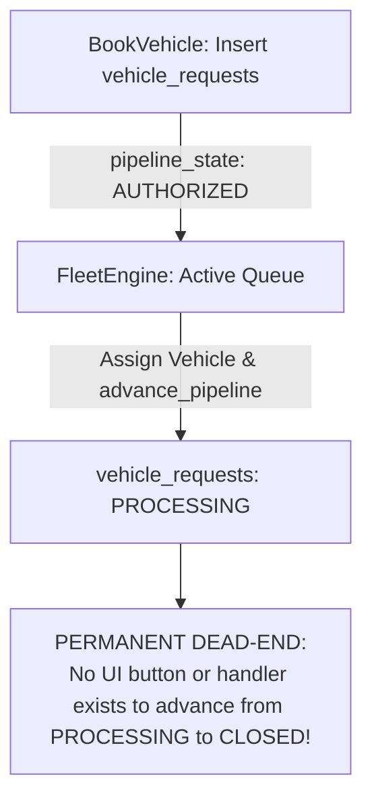

# End-to-End Business Logic, Workflow Duplication, and Optimization Audit Report

**Target Repository:** `siyanat-portal`  
**Ground Truth Schema:** `SCHEMA_REFERENCE.csv` (74 database objects: 43 RPC functions, 30 Tables)  
**Inspection Type:** 100% Non-Destructive Static Analysis & Mocked Pipeline State Simulation  
**Environment:** Al Jamea tus Saifiyah (Siddhpur Campus) • Maintenance, Logistics & Facility Management  
**Date:** October 16, 2026  

---

## Executive Summary & Findings Overview

| Metric / Category | Count / Value | Status | Summary of Results |
| :--- | :--- | :--- | :--- |
| **Database Tables Analyzed** | 30 Tables | **2 Dead Tables** | 28 tables actively queried; `bot_sessions` and `purchase_order_items` are never queried by the frontend. |
| **Database RPC Functions** | 43 Functions | **6 Dead RPCs** | 24 Triggers, 13 active callable RPCs, 6 dead callable RPCs (`process_stationery_batch_json`, `process_event_approvals`, `receive_po_atomic`, `get_my_role`, `get_user_role`, `fn_check_emergencies`). |
| **Core Pipelines Simulated** | 5 Pipelines | **5 Logical Dead-Ends** | Identified 5 critical orphaned states where tickets become stuck with no UI button to advance/close them. |
| **Edge-Case / Concurrency Bugs** | 8 Severe Flaws | **High Risk (P0/P1)** | Ghost batches on all-item rejections; permanent stock freezing on premature event closure; bypassed atomic PO receiving; missing complaint PO unblocking. |
| **Duplicated UI & Logic** | ~1,400+ LOC | **High Redundancy** | `StandardUserDashboard.tsx` is a 60% duplicate of `MyRequests.tsx` (320 shared lines). `StationeryDispatcher.tsx` is a 44% duplicate of `MaterialDispatch.tsx` (238 shared lines). |
| **Redundant Network Fetching** | 11 Pages / Hooks | **High Latency** | 11 pages re-query `profiles` on mount despite `useAuth()`; `useSystemConfig` re-fires 4 uncached queries on every mount. |

---

## Phase 1: Schema vs. Application Cross-Reference (`SCHEMA_REFERENCE.csv`)

### 1.1 Unused Database Objects (Dead Schema Weight)

#### A. Unused Tables (2 Tables)
1. **`bot_sessions`** (`jid`, `profile_id`, `current_flow`, `step`, `draft_data`, `updated_at`):  
   - **Status:** **Completely Unused in Frontend** (0 references across `src/`).  
   - **Context:** Intended for an external WhatsApp/Telegram automated conversational bot. Retained in schema but represents dead weight for the web portal.
2. **`purchase_order_items`** (`id`, `po_id`, `inventory_id`, `custom_item_name`, `requested_qty`, `unit_price`, `line_total`):  
   - **Status:** **Abandoned Legacy Table** (0 references across `src/`).  
   - **Context:** The application stores line items as a `jsonb` array inside `purchase_orders.items` and passes them directly to `generate_vendor_po(..., p_items jsonb)`. The normalized relational child table `purchase_order_items` is never written to or queried by any page or component.

#### B. Unused Callable RPC Functions (6 Functions)
1. **`receive_po_atomic`** (`p_po_id uuid, p_item_id uuid, p_received_qty numeric, p_user_email text -> RETURNS void`):  
   - **Status:** **Dead RPC Weight / Bypassed**.  
   - **Impact:** Created to safely update stock and purchase order items atomically in Postgres. Instead, `PendingPOsTab.tsx:31-109` executes an unsafe 7-step client-side loop over items.
2. **`process_stationery_batch_json`** (`p_batch_id uuid, p_decisions jsonb -> RETURNS void`):  
   - **Status:** **Superseded & Dead**.  
   - **Impact:** `StationeryDispatcher.tsx:180` calls `process_material_batch_json` instead. `process_stationery_batch_json` lacks the `p_user_email` audit parameter and is never invoked.
3. **`process_event_approvals`** (`p_event_id uuid, p_decisions jsonb, p_admin_email text -> RETURNS void`):  
   - **Status:** **Superseded & Dead**.  
   - **Impact:** Superseded by `approve_event_and_handoff`, which returns operational mobilization counts (`siyanat_items`, `avit_items`).
4. **`get_my_role`** (`-> RETURNS text`):  
   - **Status:** **Never Invoked**.  
   - **Impact:** `AuthContext.tsx:38-46` directly runs `supabase.from('profiles').select('*').eq('id', user.id).single()`.
5. **`get_user_role`** (`-> RETURNS text`):  
   - **Status:** **Never Invoked**. Same as above.
6. **`fn_check_emergencies`** (`-> RETURNS void`):  
   - **Status:** **Never Invoked**. Either an abandoned cron task or orphan trigger prototype.

#### C. Unused Columns on Active Tables
- **`events.others_count`** (default `0`): Never bound in `BookEvent.tsx` or `HeadcountEngine.tsx` (`male_count`, `female_count`, `total_count` are used).
- **`fixed_assets.purchase_date`**: Unused in `AssetRegister.tsx` (only `last_maintenance` and `next_maintenance` are utilized).
- **`asset_maintenance_logs.service_date`** (default `CURRENT_DATE`): Frontend relies on `created_at`.
- **`technician_assignments.assigned_by`**: Set in `assign_or_reassign_technician` RPC; never selected in queries.
- **`vendor_price_agreements.effective_date`** (default `CURRENT_DATE`): Ignored during price agreement upserts and displays in `VendorDirectoryTab.tsx`.
- **`work_order_items.freezed_qty`** (default `0`): Frozen stock reservations are tracked globally on `inventory_items.freezed_stock`, not line-item level.

---

### 1.2 Client-Side Work Doing Database Jobs

| Component & Lines | Client-Side JS Implementation | Existing / Preferred Database Solution | Risk / Concurrency Hazard |
| :--- | :--- | :--- | :--- |
| **`PendingPOsTab.tsx:31-109`** | Loops `for (const item of poConfirmTarget.items)`: updates PO, queries `work_order_items`, inserts `inventory_items`, calls `increment_inventory_and_freeze_stock`, updates `technician_assignments`, updates `complaints`, updates `work_orders`. | Existing RPC: `receive_po_atomic` or a consolidated `fulfill_purchase_order(p_po_id)` procedure. | **High Risk:** Non-atomic multi-step operation. If browser tab is closed midway, PO is marked `Fulfilled & Received` while stock increment or ticket unblocking fails. |
| **`MaterialDispatch.tsx:272-328`** & **`StationeryDispatcher.tsx:197-246`** | 5-step client-side operational split: inserts new `work_orders` with `${batch_id}-PO`, updates item FKs with `.in()`, updates parent work order, inserts 2 log messages. | Create Postgres RPC `split_work_order_batch(p_parent_id, p_ordered_item_ids)`. | **High Risk:** If the network drops after the first insert, an empty orphan PO batch is permanently created with no linked items. |
| **`EventsManager.tsx:143-157`** | `decisions.map(async dec => supabase.from('event_requirements').update(...))` fires N individual parallel HTTP updates before calling `approve_event_and_handoff`. | Pass `p_decisions jsonb` directly to `approve_event_and_handoff` (which already defines `p_decisions jsonb DEFAULT NULL::jsonb`). | **Medium Risk:** Unnecessary network waterfalls (N+1 queries); partial requirement update failure leaves event in limbo. |
| **`VendorDirectoryTab.tsx:160-190`** | `for (let idx = 0; idx < rows.length; idx++) { await supabase.from('vendor_price_agreements').upsert(...) }` loops sequentially over CSV rows. | Single batch query: `await supabase.from('vendor_price_agreements').upsert(allRows)`. | **Medium Risk:** UI freezes during 100+ item CSV price uploads; excessive roundtrips consume database connection pool. |
| **`NewComplaint.tsx:137-175`** | Sequential loop uploading compressed images to storage followed by single-row inserts to `complaint_photos`. | Use `Promise.all` for storage uploads, followed by a single multi-row `insert(photoRecords)`. | **Low Risk:** Slow complaint submission on mobile networks with multiple attachments. |

---

### 1.3 Type & Default Drift

1. **Role Definition Drift (`profiles.role`):**
   - **Database Schema Default:** `role (text default 'REQUESTER'::text)`.
   - **Frontend Types (`src/utils/roles.ts`):** 12 roles defined (`SUPER_ADMIN`, `ADMIN`, `SIYANAT_HEAD`, `AVIT_HEAD`, `TANZEEM_HEAD`, `DEPT_HEAD`, `SUPERVISOR`, `REQUESTER`, `EXECUTOR`, `TECHNICIAN`, `RECEPTIONIST`, `STANDARD_USER`).
   - **UI Select Dropdown (`TeamManagement.tsx:669-678`):** 9 roles offered. It uses `EXECUTOR` (never offers `TECHNICIAN`), offers `SUPER_ADMIN` (never offers `ADMIN`), offers `REQUESTER` (never offers `STANDARD_USER`).
   - **Workaround in `AuthContext.tsx:45`:** `const resolvedRole = (data?.role === 'STANDARD_USER' ? 'REQUESTER' : data?.role) as UserRole`.
   - **Verdict:** `STANDARD_USER` and `REQUESTER` are aliases; `TECHNICIAN` and `EXECUTOR` are aliases. Schema and frontend should unify on a single canonical role enum.

2. **Pipeline State vs. Legacy Status Drift:**
   - Database tables contain both `pipeline_state` (`pipeline_status` enum) and legacy text columns (`status`, `approval_status`, `dispatch_status`).
   - In `PendingPOsTab.tsx:98-101`, `complaints` is updated with `pipeline_state: 'PROCESSING'`, but `complaints.status` is ignored (retaining `'Pending Approval'`).
   - In `MaintenanceRouting.tsx:119`, `complaints` is updated with `pipeline_state: 'REJECTED'`, while `complaints.status` is unupdated.
   - In `EventsManager.tsx:234`, `events` is updated with `pipeline_state: 'REJECTED'`, while `events.status` remains `'Pending Tanzeem Approval'`.
   - **Verdict:** Read operations in dashboards now filter by `pipeline_state`, but any legacy reports or third-party webhooks reading `status` encounter stale out-of-sync values.

3. **Table Insertion Pipeline Defaults:**
   - In `SCHEMA_REFERENCE.csv`:
     - `complaints.pipeline_state` defaults to `'SUBMITTED'`.
     - `work_orders.pipeline_state` defaults to `'AUTHORIZED'`.
     - `events.pipeline_state` defaults to `'AUTHORIZED'`.
     - `vehicle_requests.pipeline_state` defaults to `'AUTHORIZED'`.
   - **Architectural Rationale:** Complaints require initial Supervisor triage (`SUBMITTED` -> `AUTHORIZED`), whereas requisitions, events, and fleet requests bypass initial supervisor review and enter directly at the department head queue (`AUTHORIZED`).

---

## Phase 2: End-to-End Functional Logic Flow Simulation (All 5 Pipelines)

### State Machine Reference Model



---

### 2.1 Pipeline 1: Maintenance & Complaint Lifecycle
**Flow:** `NewComplaint.tsx` -> `SupervisorQueue.tsx` -> `MaintenanceRouting.tsx` -> `TechnicianPortal.tsx` -> `SupervisorQueue.tsx` (Verification)



- **Logical Dead-End (P0): Material Unblocking Failure for Complaints**
  - **Location:** `VendorPOEngine.tsx:171-183` & `PendingPOsTab.tsx:90-102`.
  - **Mechanism:** When a technician requests materials for an active complaint, `TechnicianPortal.tsx:202` sets the technician assignment status to `'Waiting for Material'`. If the item requires procurement, `VendorPOEngine` generates a vendor PO. However, `generate_vendor_po` RPC has no `p_complaint_id` parameter. Thus, `purchase_orders.complaint_id` is always `NULL`.
  - **Consequence:** When the PO arrives at the dock and is received in `PendingPOsTab.tsx`, line 90 checks `if (poConfirmTarget.complaint_id)`. Because it is `NULL`, lines 91-102 never execute. The technician assignment remains frozen in `'Waiting for Material'` indefinitely unless the technician manually notices and clicks "Resume Task".
- **Edge-Case Bug: Supervisor Reopen Status Asynchrony**
  - **Location:** `SupervisorQueue.tsx:114-124`.
  - **Mechanism:** When a supervisor reopens a completed ticket, it resets `pipeline_state: 'PROCESSING'` and assignment to `'Assigned'`, but does not verify whether previously consumed materials need re-requisitioning.

---

### 2.2 Pipeline 2: Material Requisition & Split Dispatch Lifecycle
**Flow:** `NewRequisition.tsx` -> `MaterialDispatch.tsx` / `StationeryDispatcher.tsx` -> `AlternativeItemModal.tsx` -> Partial Split (`BATCH-XXXXX` vs `BATCH-XXXXX-PO`) -> `MyRequests.tsx` / `StandardUserDashboard.tsx` (`receive_work_order`)



- **Logical Dead-End (P0 - Critical): All-Rejected Items Batch Ghosting**
  - **Location:** `MaterialDispatch.tsx:329-351` & `StationeryDispatcher.tsx:247-267`.
  - **Mechanism:** When a dispatcher marks every item in a requisition as `"Not Provided"` (Reject), `availableIds.length` is 0 and `orderedIds.length` is 0. The conditional branches only test:
    ```typescript
    if (availableIds.length > 0 && orderedIds.length > 0) { ... }
    else if (availableIds.length > 0 && orderedIds.length === 0) { ... }
    else if (availableIds.length === 0 && orderedIds.length > 0) { ... }
    ```
  - **Consequence:** When `availableIds.length === 0 && orderedIds.length === 0`, **no update query is executed**. The parent work order remains stuck in `pipeline_state: 'AUTHORIZED'`, never transitioning to `'REJECTED'`. In the active queue, it displays an alert badge `"Rejected (Needs Sync)"` (lines 379-391) and remains in the active queue forever.
- **Edge-Case Bug: Non-Atomic Re-Parenting on Split**
  - **Location:** `MaterialDispatch.tsx:276-311`.
  - **Mechanism:** Splitting executes across 5 sequential client-side queries. If network connectivity drops between inserting the PO child order and re-parenting items, an empty orphan PO batch is created while items remain stranded on the parent.
- **Edge-Case Bug: Double-Click Split Collision**
  - Double clicking the "Submit Dispatch Review" button causes two parallel `insert` calls for `${reviewBatch.batch_id}-PO`, spawning duplicate procurement batches.

---

### 2.3 Pipeline 3: Procurement & Vendor PO Lifecycle
**Flow:** `RequestToOrder.tsx` -> `VendorPOEngine.tsx` / `DirectPOModal.tsx` -> `PendingPOsTab.tsx` -> Stock Injection & Parent Unblocking



- **Logical Dead-End (P1): Total Absence of Partial PO Delivery Recourse**
  - **Location:** `PendingPOsTab.tsx:23-119`.
  - **Mechanism:** `PendingPOsTab` provides only a single global action button: `"Receive & Fulfill PO"`. There is no quantity input field.
  - **Consequence:** The client unconditionally assumes 100% of line items and requested quantities arrived in pristine condition. If a supplier delivers 5 out of 10 items or defective goods, warehouse managers have no option to log partial receipts or initiate vendor returns.
- **Edge-Case Bug: Random CAT-ID Collision on Custom Items**
  - **Location:** `PendingPOsTab.tsx:45`.
  - **Mechanism:** Custom PO items without an existing catalog item ID generate an ID via `CAT-${Math.floor(10000 + Math.random() * 90000)}`. No retry loop or collision check exists. A duplicate random integer will abort the transaction with a 409 unique constraint error.
- **Edge-Case Bug: Bypassed Atomic Procedure `receive_po_atomic`**
  - **Location:** `SCHEMA_REFERENCE.csv:38` vs `PendingPOsTab.tsx:31-109`.
  - Stored procedure `receive_po_atomic` exists in Postgres specifically to perform atomic stock injection, yet the frontend executes an un-guarded client-side loop.

---

### 2.4 Pipeline 4: Event Booking & Asset Reconciliation Lifecycle
**Flow:** `BookEvent.tsx` (`book_event_safely`) -> `EventsManager.tsx` (`approve_event_and_handoff`) -> Department Handoff (`acknowledge_event_handoff`) -> Post-Event `reconcile_event_returns` & `cancel_event_by_requester`



- **Logical Dead-End (P0 - Critical): Premature Event Closure Permanently Freezes Stock**
  - **Location:** `EventsManager.tsx:401-413`.
  - **Mechanism:** On passed events (`isPassed === true`), the UI renders the `"Close Event"` button directly alongside the `"Reconcile Returns"` button.
  - **Consequence:** An administrator can click `"Close Event"` without reconciling returnable items. The handler `closeEvent()` (lines 267-278) sets `pipeline_state: 'CLOSED'` directly on `events`. The event immediately moves to the `History Log` tab. Because only `active` events display reconciliation controls, **the event's returnable items are never reconciled**, and reserved stock on `inventory_items.freezed_stock` remains locked in Postgres permanently.
- **Edge-Case Bug: Admin Event Rejection Bypasses Inventory Unfreezing**
  - **Location:** `EventsManager.tsx:228-265`.
  - **Mechanism:** When a requester cancels an event via `MyRequests.tsx`, it executes `cancel_event_by_requester` RPC, which unfreezes reserved inventory. However, when Tanzeem Admin rejects an event in `EventsManager.tsx`, it performs a raw client query:
    ```typescript
    await supabase.from('events').update({ pipeline_state: 'REJECTED' }).eq('id', targetEvent.id);
    await supabase.from('event_requirements').update({ status: 'Rejected' }).in('id', reqIds);
    ```
  - **Consequence:** No RPC or unfreeze function is triggered. If any items were reserved at approval time, their frozen counts remain stranded.

---

### 2.5 Pipeline 5: Fleet & Supporting Operations
**Flow:** `BookVehicle.tsx` -> `FleetEngine.tsx` (`advance_pipeline`) -> Supporting Operations (`AssetRegister`, `ReceptionWatchtower`, `TeamManagement`, `SystemConfigManager`, `Reports`)



- **Logical Dead-End (P0 - Critical): Total Absence of Fleet Trip Completion / Closure Action**
  - **Location:** `FleetEngine.tsx:166-191` & repository-wide scan.
  - **Mechanism:** When a vehicle request is dispatched in `FleetEngine.tsx:177`, `advance_pipeline` moves it from `AUTHORIZED` -> `PROCESSING`.
  - **Consequence:** **There is not a single UI button, form, or handler in the entire repository that closes or completes a vehicle request.** All dispatched vehicle requests in the history of the portal remain stuck in `pipeline_state = 'PROCESSING'` permanently.
- **Edge-Case Bug: Perpetual False-Positive Fleet Booking Conflicts**
  - **Location:** `FleetEngine.tsx:132-141`.
  - **Mechanism:** `getVehicleConflicts()` scans requests where `['PROCESSING', 'ACTION_REQUIRED', 'CLOSED'].includes(v.pipeline_state)`. Because old trips are never marked completed or archived, historical requests on the same date will perpetually register as active conflicts when dispatching recurring or new trips.
- **Security Edge-Case: Inconsistent Fleet Booking Guard**
  - **Location:** `App.tsx:487` vs `BookVehicle.tsx:73, 242`.
  - `App.tsx` guards the route with `canBookFleet(role)`. However, `BookVehicle.tsx` internally uses `const isStandardUser = role === 'REQUESTER'`. If an `EXECUTOR`, `TECHNICIAN`, or `RECEPTIONIST` navigates to `/book-vehicle`, the page does not restrict them from submitting vehicle requests.

---

## Phase 3: Duplication of Work & Redundant Code Audit

### 3.1 UI & Page Duplication (Code Clone Analysis)

```
+-----------------------------------------------------------------------------------------+
| DUPLICATED PAIR 1: MyRequests.tsx (782 lines) vs. StandardUserDashboard.tsx (598 lines) |
| Identical significant code lines: 320 lines (60.0% of StandardUserDashboard)             |
+-----------------------------------------------------------------------------------------+
| - Identical state declarations (cancelModalEvent, stats, materials, complaints, events)  |
| - Identical fetch queries for work_orders, complaints, events, and vehicle_requests     |
| - Identical handleConfirmReceipt calling receive_work_order                              |
| - Identical handleCancelSubmit calling cancel_event_by_requester                         |
| - Identical 4 tabs (Materials, Maintenance, Events, Fleet) with identical UI cards      |
| - Identical cancellation reason modal and toast notifications                           |
| RATIONALE: StandardUserDashboard was created for '/' and MyRequests for '/my-requests'.  |
+-----------------------------------------------------------------------------------------+

+-----------------------------------------------------------------------------------------+
| DUPLICATED PAIR 2: MaterialDispatch.tsx (800 lines) vs. StationeryDispatcher.tsx (606)  |
| Identical significant code lines: 238 lines (43.5% of StationeryDispatcher)              |
+-----------------------------------------------------------------------------------------+
| - Identical review modal & itemDecisions state machine                                  |
| - Identical AlternativeItemModal integration and log writing                            |
| - Identical call to process_material_batch_json RPC                                      |
| - Identical 5-step operational split logic into ${batch_id}-PO                          |
| - Identical printDispatchSlip integration                                                |
| RATIONALE: StationeryDispatcher is a 1-to-1 clone of MaterialDispatch restricted to     |
| fulfillment_dept = 'TANZEEM_HEAD'. MaterialDispatch already accepts userRole prop.       |
+-----------------------------------------------------------------------------------------+

+-----------------------------------------------------------------------------------------+
| DUPLICATED PAIR 3: Role Dashboards Maroon Welcome Banners                                |
| AdminDashboard (234 lines), SiyanatDashboard (116 lines), SupervisorDashboard (152),     |
| TanzeemDashboard (118 lines)                                                            |
+-----------------------------------------------------------------------------------------+
| - Identical Tailwind container: bg-gradient-to-r from-brand-maroon to-brand-dark        |
| - Identical blur background circle: w-64 h-64 bg-brand-gold opacity-5 rounded-full blur  |
| - Identical header typography, subtitle layout, and role badge badge styling             |
+-----------------------------------------------------------------------------------------+
```

---

### 3.2 Redundant Network Fetching & Missing State Caching

1. **Redundant Profile Re-Fetching on Every Page Mount (11 Pages):**
   - In `AuthContext.tsx`, `useAuth()` already fetches the logged-in user's profile and single source-of-truth role once upon authentication.
   - Despite this, **11 different pages** make redundant network round-trips to Supabase to query their own profile again:
     1. `BookEvent.tsx:65`
     2. `dashboards/SiyanatDashboard.tsx:20`
     3. `dashboards/SupervisorDashboard.tsx:20`
     4. `MyRequests.tsx:94`
     5. `NewComplaint.tsx:75`
     6. `NewRequisition.tsx:68`
     7. `RequestToOrder.tsx:43`
     8. `SiyanatOperations.tsx:14`
     9. `StandardUserDashboard.tsx:89`
     10. `SupervisorQueue.tsx:48`
     11. `TechnicianPortal.tsx:34`
   - **Performance Impact:** Eliminating these 11 duplicate queries will shave 100-300ms off every route transition.

2. **Uncached System Config Multi-Query Execution (`useSystemConfig.ts`):**
   - Every time a component calls `useSystemConfig()`, it fires **4 parallel database queries**:
     - `supabase.from('academic_classes').select('*')`
     - `supabase.from('technician_trades').select('*')`
     - `supabase.from('inventory_categories').select('*')`
     - `supabase.from('system_settings').select('*')`
   - Mounted by: `HeadcountEngine.tsx`, `BulkRestockTab.tsx`, `CatalogTab.tsx`, `BookVehicle.tsx`, `TeamManagement.tsx`.
   - **Performance Impact:** Switching between tabs on `RestockInventory` re-executes these 4 queries every time. Wrapping this in a React Context (`ConfigContext`) or session cache will eliminate ~20 unnecessary queries per session.

3. **High-Frequency Workload Badge Polling (`useWorkloadBadges.ts`):**
   - Polls 4 separate count queries every 20 seconds:
     - `complaints` (`pipeline_state = 'SUBMITTED'`)
     - `work_orders` (`items.status = 'Pending'`)
     - `technician_assignments` (`status = 'Assigned'`)
     - `work_order_items` (`status = 'Ordered'`)
   - **Optimization:** Consolidate these 4 counts into a single lightweight database function `get_workload_badge_counts(p_user_id, p_role)` returning a single JSON object.

---

### 3.3 Dead Code & Unused Exports

1. **Dead Hook File:**
   - **`src/hooks/usePushNotificationSync.ts`** (42 lines): Completely unused. `App.tsx:66-104` defines an identical function inline. The file is never imported anywhere in the project.
2. **Unused Utility Functions in `src/utils/roles.ts`:**
   - `ELEVATED_REQUESTER_ROLES` (Lines 15-22): Never imported.
   - `canBookAfterClassEvents` (Lines 29-32): Never imported.
   - `isDepartmentHead` (Lines 34-36): Never imported.
   - `isTechnicianRole` (Lines 38-40): Never imported.
   - `isSupervisorRole` (Lines 42-44): Never imported.
3. **Unused Location Constants in `src/constants/locations.ts`:**
   - `MAINTENANCE_ZONES` (Lines 46-52): Never imported.
   - `MAZAR_LOCATIONS` (Lines 54-60): Never imported.
   - Unused type exports: `SubLocationType`, `SubLocationConfig`, `VenueConfig`.
4. **Unused Static Media Assets in `src/assets/`:**
   - `hero.png` (13 kB): Unreferenced.
   - `react.svg` (4 kB): Vite template asset; unreferenced.
   - `vite.svg` (8 kB): Vite template asset; unreferenced.

---

## Phase 4: Architectural Verdict Matrix

```
+------------------------------------------------------------------------------------+
|                               ARCHITECTURAL VERDICT MATRIX                         |
+---------------------------------+--------------------------------------------------+
| CATEGORY                        | TARGET MODULES & ACTIONABLE VERDICT              |
+---------------------------------+--------------------------------------------------+
| 🟢 KEEP AS-IS                   | 1. BookEvent.tsx + book_event_safely RPC        |
|    (Solid, secure, verified)    | 2. MaintenanceRouting.tsx + assign RPC           |
|                                 | 3. VendorPOEngine.tsx + generate_vendor_po RPC   |
|                                 | 4. SystemConfigManager.tsx + AuditLogs.tsx       |
|                                 | 5. VisualPipelineStepper.tsx                     |
|                                 | 6. ForcePasswordChange.tsx                       |
+---------------------------------+--------------------------------------------------+
| 🔴 NOT NEEDED / SAFE TO REMOVE  | 1. StandardUserDashboard.tsx (Route '/' to       |
|    (Redundancies to eliminate)  |    MyRequests.tsx directly; delete 598 lines)    |
|                                 | 2. StationeryDispatcher.tsx (Reuse               |
|                                 |    MaterialDispatch.tsx; delete 606 lines)       |
|                                 | 3. src/hooks/usePushNotificationSync.ts          |
|                                 | 4. Unused roles.ts helpers & location constants  |
|                                 | 5. Unused template assets (hero.png, *.svg)      |
|                                 | 6. Dead DB objects (bot_sessions, unused RPCs)   |
+---------------------------------+--------------------------------------------------+
| 🟡 HIGH-VALUE OPTIMIZATIONS     | 1. Fix All-Rejected batch ghosting bug           |
|    (Low risk, high reward)      | 2. Add vehicle trip completion button            |
|                                 | 3. Guard closeEvent against unreconciled returns |
|                                 | 4. Wire receive_po_atomic in PendingPOsTab       |
|                                 | 5. Pass p_complaint_id to generate_vendor_po     |
|                                 | 6. Create ConfigContext for useSystemConfig      |
|                                 | 7. Remove 11 redundant profile queries           |
+---------------------------------+--------------------------------------------------+
```

---

## Phase 5: Prioritized Optimization Roadmap

### Priority 0: Critical Business Logic & Data Integrity Fixes (Immediate)

1. **Fix All-Rejected Batch Ghosting (`MaterialDispatch.tsx:329` & `StationeryDispatcher.tsx:247`)**
   - **Fix:** Add the missing condition when `availableIds.length === 0 && orderedIds.length === 0`:
     ```typescript
     else if (availableIds.length === 0 && orderedIds.length === 0) {
       await supabase.from('work_orders').update({
         pipeline_state: 'REJECTED',
         dispatch_status: 'Rejected'
       }).eq('id', reviewBatch.id);
       showToast("All items marked Not Provided. Requisition rejected.", "warning");
     }
     ```
2. **Add Vehicle Trip Completion in `FleetEngine.tsx`**
   - **Fix:** Add a `"Complete Trip"` action button in `FleetEngine.tsx` for vehicle requests in `PROCESSING` state that calls:
     ```typescript
     await supabase.rpc('advance_pipeline', {
       target_table: 'vehicle_requests',
       target_id: request.id
     });
     ```
     This advances `pipeline_state` from `PROCESSING` -> `CLOSED` and frees vehicle plates from active conflict checks.
3. **Prevent Premature Event Closure Without Reconciliation (`EventsManager.tsx:401`)**
   - **Fix:** In `EventsManager.tsx`, disable or hide the `"Close Event"` button if any requirement has `return_status === 'PENDING_RETURN'`:
     ```typescript
     const hasUnreturnedAssets = e.requirements?.some(r => r.return_status === 'PENDING_RETURN');
     // Disable button and show tooltip: "Reconcile returns before concluding event"
     <button disabled={hasUnreturnedAssets} ...>Close Event</button>
     ```
4. **Connect Complaint Unblocking to Purchase Orders (`VendorPOEngine.tsx` & DB)**
   - **Fix:** Add `p_complaint_id uuid DEFAULT NULL::uuid` to `generate_vendor_po` RPC and pass `batch.complaint_id` from `VendorPOEngine.tsx`. This enables `PendingPOsTab.tsx:90-102` to unblock technician assignments upon delivery.

---

### Priority 1: High-Yield Code Deduplication & File Deletions (Quick Wins)

1. **Unify `StandardUserDashboard.tsx` into `MyRequests.tsx` (Save ~600 LOC)**
   - In `src/pages/Dashboard.tsx:38`, replace `<StandardUserDashboard />` with `<MyRequests />`.
   - Delete `src/pages/StandardUserDashboard.tsx`.
   - **Benefit:** Instant elimination of 600 lines of duplicate code; bug fixes to request tracking will immediately reflect on the home dashboard.
2. **Unify `StationeryDispatcher.tsx` into `MaterialDispatch.tsx` (Save ~606 LOC)**
   - In `TanzeemCommandCenter.tsx:5`, import `MaterialDispatch` and render `<MaterialDispatch userRole="TANZEEM_HEAD" />`.
   - Delete `src/components/tanzeem/StationeryDispatcher.tsx`.
   - **Benefit:** Eliminates 606 lines of duplicate code and ensures Tanzeem stationery dispatching inherits all future enhancements to material logistics.
3. **Delete Dead Hook & Assets**
   - Delete `src/hooks/usePushNotificationSync.ts` (or import it into `App.tsx` and delete the duplicate lines 66-104 in `App.tsx`).
   - Remove unused assets: `src/assets/hero.png`, `src/assets/react.svg`, `src/assets/vite.svg`.
   - Clean up unused exports in `src/utils/roles.ts` and `src/constants/locations.ts`.

---

### Priority 2: Performance & Network Optimization

1. **Eliminate 11 Redundant Profile Re-Fetches**
   - In `BookEvent.tsx`, `SupervisorQueue.tsx`, `TechnicianPortal.tsx`, `SiyanatDashboard.tsx`, `SupervisorDashboard.tsx`, etc., remove the local `supabase.from('profiles').select('*').eq('id', user.id)` calls.
   - Consume `{ profile, role }` directly from `useAuth()`.
2. **Introduce Global Cache for `useSystemConfig.ts`**
   - Wrap `academic_classes`, `technician_trades`, `inventory_categories`, and `system_settings` in a React `ConfigContext`.
   - Only fetch once on initial application load, eliminating 4 queries on every sub-tab transition.
3. **Consolidate `useWorkloadBadges.ts` into a Single RPC**
   - Replace 4 separate Supabase count queries with a single RPC call `get_workload_badge_counts()` that aggregates counts server-side in a single query.

---

### Priority 3: Strategic Database Optimization

1. **Deprecate Dead Tables & Functions in Supabase**
   - Archive or drop table `purchase_order_items` (frontend standard is `purchase_orders.items` jsonb).
   - Drop dead RPC functions: `process_stationery_batch_json`, `process_event_approvals`, `get_my_role`, `get_user_role`.
2. **Implement Server-Side Batch Splitting Procedure**
   - Create `split_work_order_batch(p_batch_id, p_decisions)` in PostgreSQL to perform the parent-child work order split atomically in a single transaction, eliminating client-side concurrency vulnerabilities.
